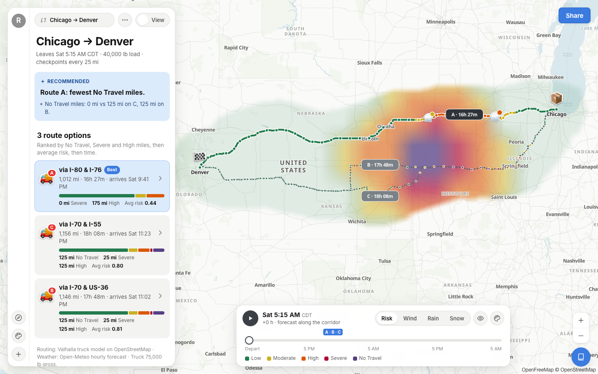
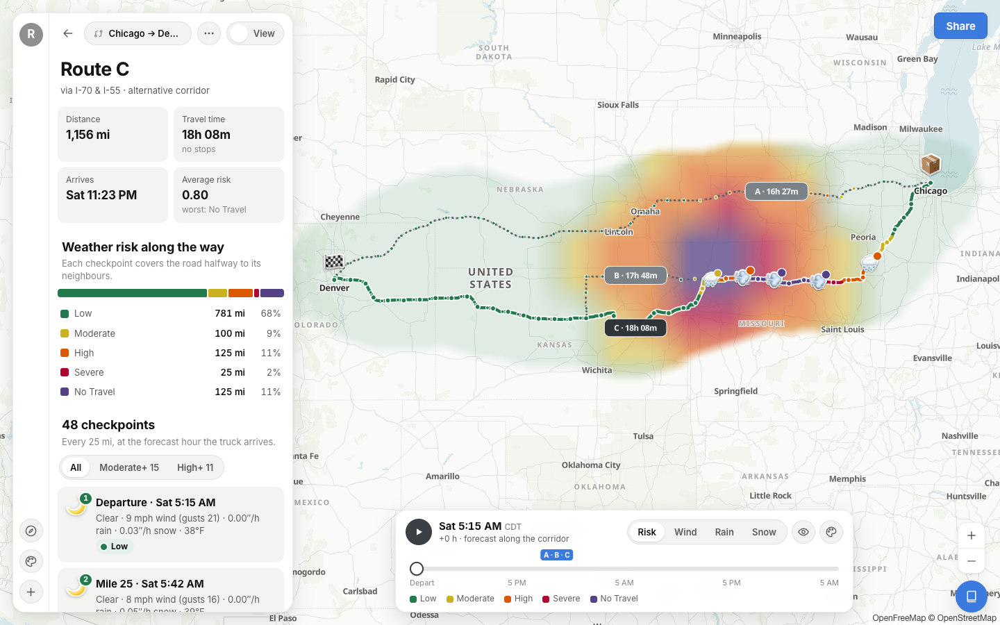
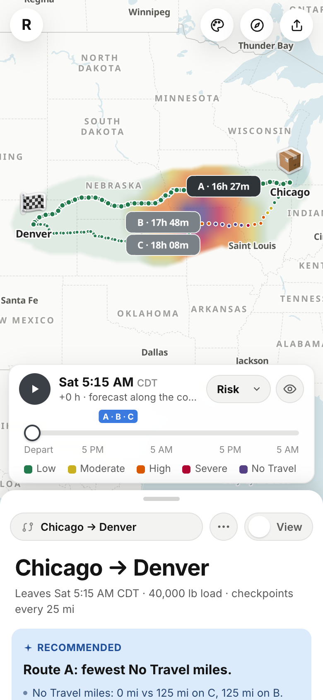
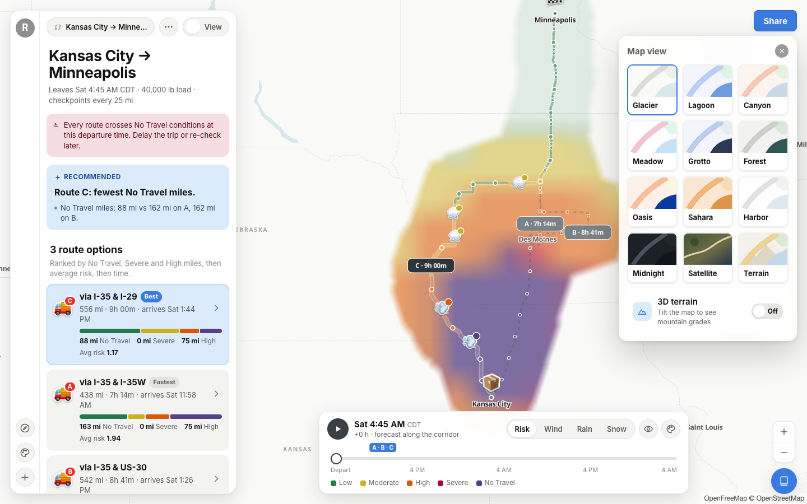
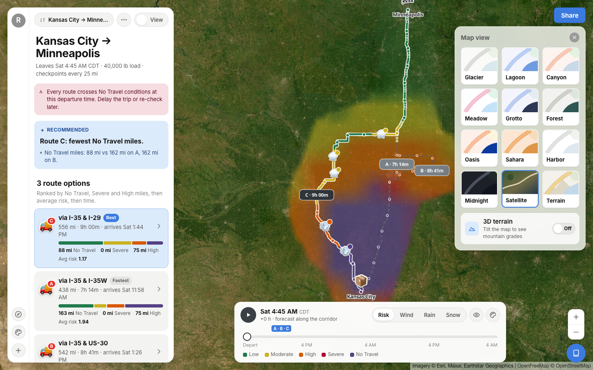
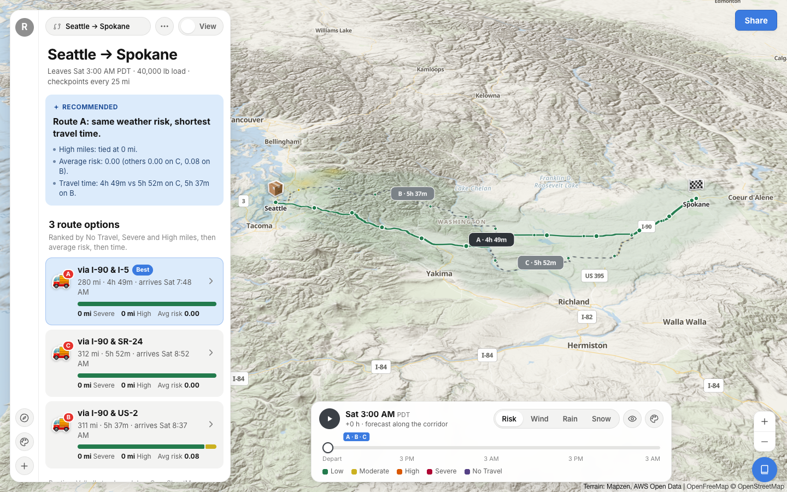

# Routecast · weather-aware truck routing

Routecast helps a truck driver pick the safest of three real routes. For every route it places a checkpoint every
10, 25 or 50 miles, works out **when the truck will reach it**, reads the hourly forecast for *that* hour, rates the
risk with the brief's wind/rain/snow and load-weight rules, and recommends the route with the fewest dangerous miles.
A 0–48 h weather heatmap along the corridor shows how conditions move while you drive.

React + TypeScript + MapLibre on the front, Django + DRF on the back. Routing, geocoding, weather and map tiles are
real third-party services, and none of them needs an API key.

**Live app:** _add the Render URL here_ · **Walkthrough:** _add the Loom link here_

| Desktop | Route detail | Mobile |
| --- | --- | --- |
|  |  |  |
| **Map views** | **Satellite** | **Terrain, 3D** |
|  |  |  |

<sub>The risk colours in these shots come from the development storm overlay (see [Testing](#testing)); real
forecasts are often calm.</sub>

## What it does

| Brief | Where |
| --- | --- |
| Origin, destination, departure, load weight | Trip form; places come from Photon (OpenStreetMap). Departure is entered in the **origin's local time** |
| 3 route options from a routing API | Valhalla truck routing (gross weight, height, width, length) plus OSRM for long-haul corridors; see [Routing](#routing) |
| Weather every 10 / 25 / 50 mi at the truck's ETA | Checkpoints with per-checkpoint ETA, optionally including hours-of-service breaks; Open-Meteo hourly forecast |
| Risk from the provided rules | `backend/planner/services/risk.py`, with every boundary unit-tested |
| Recommend the best route | Fewest No Travel → Severe → High miles → lowest average risk → shortest time, explained in plain words |
| Routes, checkpoints, risk, ETAs, summaries on a map | Risk-coloured route, weather stickers per checkpoint, hover readouts, route cards, checkpoint list |
| Heatmap with a 0–48 h slider | Corridor grid (risk, wind, rain or snow), scrubbable or played, with each truck's position at that hour |

Also: 12 map views (light themes, Midnight, Satellite, Terrain, optional 3D terrain), shareable links that re-plan
on open, a full mobile layout, and a risk-rules sheet generated from the backend's own thresholds.

## How the logic works

### Routing

1. **Regional trips** (straight-line distance up to ~1,500 km): one Valhalla `truck` request returns the best route
   plus up to two alternates. Gross weight is the entered load plus a 35,000 lb tractor-and-trailer tare
   (`TRUCK_TARE_WEIGHT_LB`).
2. **Long-haul trips:** the public Valhalla server rejects longer requests. OSRM finds the corridors instead (no
   distance limit, but car-only). Each corridor is then **re-routed by Valhalla's truck model** in stitched
   requests: waypoints every ~450 km along the corridor carry the direction of travel, so pieces join without
   U-turns. If Valhalla can't route a piece, that option keeps OSRM's geometry, re-timed so no segment beats
   65 mph, and the UI says so.
3. **Always three distinct options.** Routes sharing ≥ 80% of their combined length count as the same option.
   Missing options are forced through a highway point offset 18%, then 32%, of the trip length to either side of the
   straight line at the midpoint. Options more than 40% slower than the fastest are dropped. Only if no distinct third
   corridor exists (e.g. a short hop) does the app show fewer routes, and it says why.

Every vertex of the route carries a cumulative distance and drive time (Valhalla maneuver times spread by distance;
OSRM per-segment durations). That's what makes checkpoint ETAs precise.

### Checkpoints, ETAs and weather

- Checkpoints sit at 0, N, 2N … miles plus the destination. Each one **owns the road halfway to its neighbours**, so
  miles per risk level always add up to the route length.
- **ETA** = departure + drive time to that point. With the *Hours-of-service* toggle, ETAs include a 30-minute
  break after 8 h driving and a 10 h rest after 11 h (FMCSA limits, simplified). On multi-day trips that changes
  which forecast hour is sampled.
- **Forecast hour:** Open-Meteo reports precipitation as the total for the hour *ending* at each timestamp, while
  wind is instantaneous. A truck at a checkpoint at 14:20 is in the 14:00–15:00 hour, so rain and snow come from the
  15:00 value, and wind is interpolated between 14:00 and 15:00.
- Checkpoints are fetched in bulk (Open-Meteo accepts many coordinates per request) and cached for 20 minutes.
  Long trips snap nearby checkpoints to a shared ~3–5 km grid point, coarsening only as needed to stay inside the
  free tier (≤ 150 forecast locations per plan; model grids are 3–25 km anyway).

### Risk rules

Bands follow the brief. Its ranges share end points ("0.10–0.25", "0.25–0.50"), so **each band includes its lower
bound**: 0.25 in/hr rain is High, 34.9 mph is Moderate, 35 mph is High. The top bands are written differently in the
brief and stay that way: wind is No Travel at **≥ 55** mph, while rain and snow are No Travel only **above** 1.00 and
3.0 in/hr.

| Level | Wind (mph) | Rain (in/hr) | Snow (in/hr) |
| --- | --- | --- | --- |
| Low | < 25 | < 0.10 | < 0.5 |
| Moderate | 25–34 | 0.10–0.25 | 0.5–1.0 |
| High | 35–44 | 0.25–0.50 | 1.0–2.0 |
| Severe | 45–54 | 0.50–1.00 | 2.0–3.0 |
| No Travel | ≥ 55 | > 1.00 | > 3.0 |

Load rules only ever escalate the wind level: 45–54 mph with a load over 30,000 lb → No Travel; 35–44 mph over
40,000 lb → Severe. A checkpoint's level is the worst of wind (after load rules), rain and snow, and the UI names the
condition that set it and any load rule that fired.

Measurement choices: wind is the **sustained 10 m wind speed** (gusts are shown but don't set the level), rain is
liquid precipitation (rain + showers), snow is snowfall, all per hour.

### Recommendation

Routes are ranked lexicographically on

1. **No Travel miles** (added: a route through No Travel weather is never the safer one),
2. Severe miles, 3. High miles, 4. mile-weighted average risk (Low = 0 … No Travel = 4), 5. travel time.

Mileages compare at 0.1 mi and the average at 0.01, so floating-point noise never decides. The card states the
deciding criterion ("Route C: fewest No Travel miles — 88 mi vs 162 mi on A, 162 mi on B"). If every route
crosses Severe or No Travel weather, the app says so and suggests delaying.

### Heatmap

The backend builds a grid that is **regular in Web Mercator** over the corridor: a buffer of 8.5% of the trip
length (30–140 km) around every route, morphologically *closed* so narrow gaps between alternatives fill in while
far-apart corridors stay separate. The cell size adapts so a plan uses at most 120 forecast locations. Frames run
hourly from the departure hour for 48 h, with risk computed server-side using the same rules and load.

The browser draws each frame into one image stretched over the grid, so it lines up with the map exactly:

- values are upsampled bilinearly and *then* coloured, so gradients follow the colour ramp;
- hours cross-fade, so the slider moves smoothly between forecast steps;
- the corridor outline comes from a distance field of the routes, giving a smooth ribbon rather than coarse cells;
- frames re-render on demand through `ImageSource.updateImage`. Playing the timeline (heatmap redraw plus truck
  markers every frame) holds 60 fps in Chrome: p95 frame time 16.7 ms over 4 s, measured with the
  production build.

Hovering any point gives its value. The slider is anchored at the departure time and also moves a truck marker
along each route.

### Colour

Risk levels use one fixed status scale (green → amber → orange → crimson → purple). It was checked with a palette
validator for colour-blind (protan/deutan) and normal-vision separation between neighbouring levels. Wind, rain and
snow heatmaps each use a single-hue ramp whose steps sit on the risk thresholds. Colour is never the only cue:
every level is also labelled, and every value shown on the map also appears in the panel.

## Design

The UI follows the PamPam web app reference screens (supplied separately, not committed):

- the floating left card with an icon rail, a search-style trip pill, a ⋯ menu and the View/Edit toggle;
- grey field groups, peach suggestion chips and search results, and the blue Share / primary buttons;
- emoji "stickers" with red numbered badges;
- dotted route lines with grey duration pills;
- the frosted *Themes* grid, the Share modal with switch rows, the "On it" loading card and toasts.

The nine PamPam themes (Glacier … Harbor) are rebuilt as MapLibre styles from colours sampled off the screenshots,
including the hand-drawn water squiggles.

On phones the panel becomes a draggable bottom sheet (peek / half / full), the forecast tray docks above it, and
search and overlays go full-screen.

## Running it

Requirements: Python 3.12+, Node 20+. With `make`: `make setup`, then `make backend` and `make frontend` in two
terminals, and `make test`. By hand:

```bash
# API on :8000
cd backend
python3.12 -m venv .venv && .venv/bin/pip install -r requirements-dev.txt
DEBUG=1 .venv/bin/python manage.py runserver

# App on :5173 (proxies /api to :8000)
cd frontend
npm ci && npm run dev
```

Open http://localhost:5173 and try one of the example trips.

### Testing

```bash
cd backend && .venv/bin/pytest      # 113 tests, 95% coverage: rules, sampling, HOS, weather hours, ranking,
                                    # routing, heatmap, API, and every upstream adapter against mocked HTTP
cd frontend && npm test             # time zones/DST, geometry, ramps, share links
cd frontend && npm run typecheck
```

`DEBUG=1 SIMULATE_STORM=1` overlays a synthetic storm on the real forecasts, drifting across the Plains, so the risk
colours, load rules and recommendation can be checked on a calm day. It is ignored unless `DEBUG` is on and is never
cached as real data.

## Deploying

The Dockerfile builds the React app and serves it, plus the API, from one gunicorn process (WhiteNoise, Brotli
pre-compressed, immutable asset caching).

- **Render:** *New → Blueprint* → this repository (`render.yaml` sets the secret key, hosts and health check).
- **Anywhere else:** `docker build -t routecast . && docker run -p 8000:8000 -e SECRET_KEY=… -e ALLOWED_HOSTS=your.host routecast`

| Variable | Default | Purpose |
| --- | --- | --- |
| `SECRET_KEY` | – (required) | Django secret |
| `ALLOWED_HOSTS` | – | Comma-separated hosts (`.onrender.com` works) |
| `VALHALLA_URL` / `VALHALLA_API_KEY` | FOSSGIS public server | Self-hosted or Stadia Valhalla removes the 1,500 km stitching |
| `OSRM_URL` | router.project-osrm.org | Long-haul corridor finder / fallback |
| `OPEN_METEO_API_KEY` | – | Commercial Open-Meteo (lifts free-tier limits) |
| `TRUCK_TARE_WEIGHT_LB`, `TRUCK_MAX_SPEED_MPH` | 35000, 65 | Truck model |
| `MAX_CHECKPOINT_LOCATIONS`, `MAX_HEATMAP_CELLS` | 150, 120 | Forecast budget per plan |
| `THROTTLE_PLAN`, `THROTTLE_HEATMAP`, `THROTTLE_GEOCODE` | 20/min, 20/min, 120/min | Per-IP API throttles |
| `CORS_ALLOWED_ORIGINS` | – | Only if the frontend is hosted separately (`VITE_API_BASE` at build) |
| `HTTP_USER_AGENT` | `routecast/1.0 (…)` | Identify your deployment (add a contact) to the public services |

## API

| Endpoint | |
| --- | --- |
| `POST /api/plan` | `{origin, destination, departure, timezone?, load_weight_lb, interval_mi, hos_breaks}` → routes, checkpoints, risk, recommendation |
| `POST /api/heatmap` | The plan's `heatmap_request` → corridor grid + 49 hourly frames per layer |
| `GET /api/geocode?q=` · `/api/reverse` · `/api/timezone` | Place search, reverse geocoding, origin time zone |
| `GET /api/rules` | Thresholds and load rules (the UI legend reads these) |

Errors always come back as `{"error": {"code", "message", "fields"?}}`.

## Limits and assumptions

- **Public services:** Valhalla (FOSSGIS), OSRM demo, Photon and Open-Meteo are free and fair-use. A
  cross-country plan takes ~10–15 s, because long routes are truck-routed in several stitched requests. Plans and
  forecasts are cached; throttling protects the upstream services. Point the env vars at keyed or self-hosted
  instances for production use.
- **Departure:** must be within 7 days (forecast range). It's interpreted in the origin's time zone, and all times
  show in that zone.
- **Long-haul fallback:** when Valhalla can't route a long-haul piece, that option uses car-network geometry, which
  doesn't check heavy-vehicle restrictions. It is labelled in the UI.
- **HOS model:** a simplified schedule (no on-duty, non-driving time and no 70-hour cycle). It's off by default.

## Project layout

```
backend/
  config/            settings (env-driven), urls (API + SPA fallback)
  planner/
    services/        geo, routing/ (valhalla, osrm, options), sampling, hos, weather, risk, scoring, heatmap, planner
    serializers.py   request validation · views.py · api_errors.py (error envelope)
    tests/           pytest suite (offline; external services are stubbed)
frontend/src/
  map/               controller (imperative MapLibre), style + themes, heat renderer, generated stickers
  components/        panel, plan form + search, results + route detail, forecast tray, overlays, mobile sheet
  state/store.ts     zustand store: trip draft, plan/heatmap lifecycle, selection, timeline
  lib/               geometry, time zones, risk colours, share links (+ unit tests)
```
